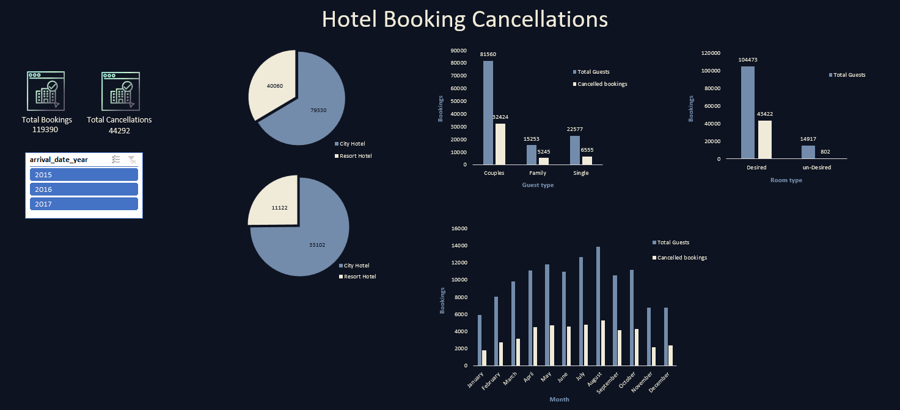
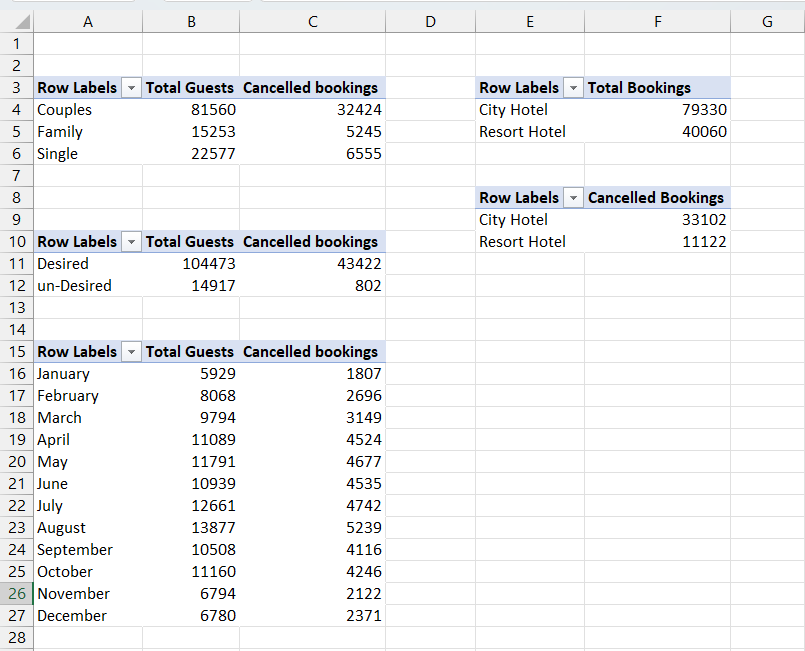
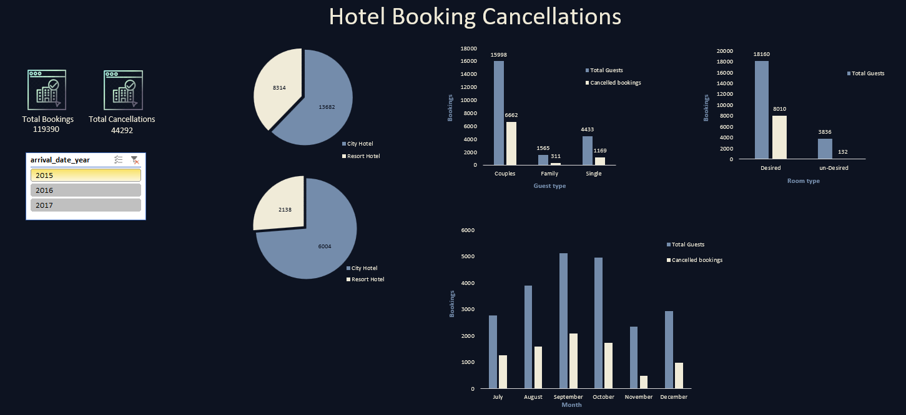
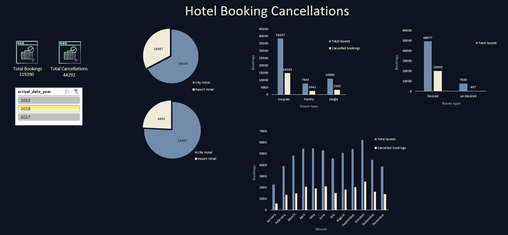
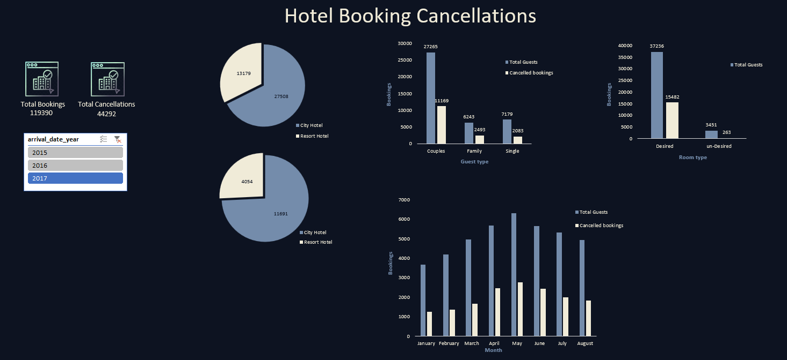

# Hotel Booking Data Analysis & Interactive Dashboard

An Excel-based data analytics project exploring hotel booking patterns, cancellation trends, customer segments, and hotel performance through PivotTables, charts, and an interactive dashboard.

## Project Overview

This project analyses approximately 119,390 hotel booking records from City Hotels and Resort Hotels, covering bookings between July 2015 and August 2017.

Microsoft Excel was used to explore booking patterns, compare hotel performance, analyse cancellations, and present findings through an interactive dashboard with year-based filtering.

## Dashboard Preview

### Overall Dashboard

### PivotTable Analysis

## Interactive Dashboard – Year-wise Analysis

The dashboard includes an arrival-year slicer to explore booking and cancellation patterns across different years.

### 2015 Analysis

### 2016 Analysis

### 2017 Analysis

## Key Analysis Areas

- Hotel-wise booking distribution (City Hotel vs Resort Hotel)
- Booking cancellation analysis
- Customer segmentation (Couples, Families, and Singles)
- Monthly booking trends
- Desired vs. undesired room allocation analysis
- Year-wise booking and cancellation comparisons

## Dashboard Features

- Interactive Excel dashboard
- Year-based filtering using Excel Slicers
- PivotTable-based data summaries
- PivotCharts for visual analysis
- KPI indicators for total bookings and cancellations
- Dynamic visual comparisons across booking categories

## Tools & Technologies

- Microsoft Excel
- PivotTables
- PivotCharts
- Excel Slicers
- Data Analysis
- Data Visualization
- Dashboard Development

## Dataset Information

- **Dataset:** Hotel Booking Demand
- **Source:** [Kaggle – Hotel Booking Dataset](https://www.kaggle.com/datasets/mojtaba142/hotel-booking)
- **Records:** 119,390
- **Time Period:** July 2015 – August 2017
- **Hotel Types:** City Hotel and Resort Hotel

### Data Privacy

According to the Kaggle dataset description, the original customer-identifying information was removed. The columns `name`, `email`, `phone-number`, and `credit_card` were artificially generated and added to the dataset.

### Acknowledgements

Original dataset authors: Nuno Antonio, Ana Almeida, and Luis Nunes.

Original research: *Hotel Booking Demand Datasets*, Data in Brief, Volume 22, February 2019.

**Attribution:** Data files © Original Authors. Refer to the original Kaggle dataset page for licensing and usage information.

## How to Explore the Project

1. Download the Excel workbook from this repository.
2. Open it using Microsoft Excel.
3. Navigate to the Dashboard sheet.
4. Use the arrival-year slicer to filter the dashboard.
5. Explore the PivotTable analysis and visualizations.

## Project Objective

To demonstrate practical data analytics and visualization skills by transforming hotel booking data into structured analysis and an interactive Excel dashboard.

## Author

**Mohammed Amanuddin Khazi**

[GitHub Profile](https://github.com/Amanuddin-Khazi)
